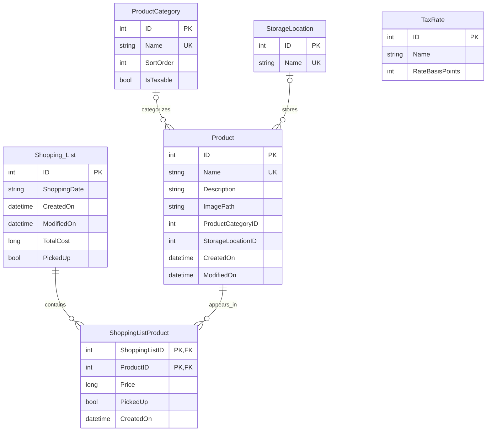

# Data Model

Shopping App uses a local SQLite database named `shopping.db3`. Database access is centralized in `Data/AppDatabase.cs`.

## Entity relationship overview



`TaxRate` is intentionally independent from individual lists and products. The app currently treats the first TaxRate row as the active app-wide sales-tax setting.

## ProductCategory

| Column | Storage | Null? | Notes |
| --- | --- | :---: | --- |
| `ID` | INTEGER | No | Auto-increment primary key. |
| `Name` | TEXT | No | Unique category name. |
| `SortOrder` | INTEGER | No | Controls Product-form category order. |
| `IsTaxable` | INTEGER | No | SQLite boolean; category-level tax rule. |

Taxability was intentionally moved out of Product and into ProductCategory so all products in one category share the same tax rule.

## StorageLocation

| Column | Storage | Null? | Notes |
| --- | --- | :---: | --- |
| `ID` | INTEGER | No | Auto-increment primary key. |
| `Name` | TEXT | No | Unique display name. |

There is no stored sort-order column. The Product form sorts locations alphabetically.

## Product

| Column | Storage | Null? | Notes |
| --- | --- | :---: | --- |
| `ID` | INTEGER | No | Auto-increment primary key. |
| `Name` | TEXT | No | Unique. App validation compares names case-insensitively after trimming. |
| `Description` | TEXT | Yes | Optional description. |
| `ImagePath` | TEXT | Yes | Relative private-storage path reserved for one product image. |
| `ProductCategoryID` | INTEGER | Yes | Indexed lookup to ProductCategory. Nullable for older records. |
| `StorageLocationID` | INTEGER | Yes | Indexed lookup to StorageLocation. |
| `CreatedOn` | INTEGER | No | UTC DateTime stored as .NET ticks. |
| `ModifiedOn` | INTEGER | Yes | UTC DateTime ticks when updated. |

### Lookup relationship note

`ProductCategoryID` and `StorageLocationID` are logical relationships validated by application code. They are indexed, but the current Product table does not declare SQL foreign-key constraints for them. This matters when changing lookup deletion behavior.

## Shopping_List

The table name intentionally contains an underscore: `Shopping_List`.

| Column | Storage | Null? | Notes |
| --- | --- | :---: | --- |
| `ID` | INTEGER | No | Auto-increment primary key. |
| `ShoppingDate` | TEXT | Yes | Stored as `yyyy-MM-dd`; exposed as `DateOnly?`. |
| `CreatedOn` | INTEGER | No | UTC DateTime ticks. |
| `ModifiedOn` | INTEGER | Yes | UTC DateTime ticks. |
| `TotalCost` | INTEGER | Yes | Whole cents; exposed to app code as `decimal?`. |
| `PickedUp` | INTEGER | No | SQLite boolean. |

The persisted TotalCost is the currently calculated total for the list, not an independent manually entered amount.

## ShoppingListProduct

This is the many-to-many link between Product and Shopping_List, with shopping-trip-specific state.

| Column | Storage | Null? | Notes |
| --- | --- | :---: | --- |
| `ShoppingListID` | INTEGER | No | Composite PK; FK to `Shopping_List.ID`. |
| `ProductID` | INTEGER | No | Composite PK; FK to `Product.ID`. |
| `Price` | INTEGER | No | Whole cents. |
| `PickedUp` | INTEGER | No | Per-item pickup state. |
| `CreatedOn` | INTEGER | No | UTC DateTime ticks. |

The primary key is:

```text
(ShoppingListID, ProductID)
```

That prevents the same Product from appearing twice in one Shopping List while still allowing it to appear in any number of different lists.

Both declared foreign keys use:

```text
ON DELETE RESTRICT
ON UPDATE RESTRICT
```

An index on `ProductID` supports reverse lookups and foreign-key checks.

## TaxRate

| Column | Storage | Null? | Notes |
| --- | --- | :---: | --- |
| `ID` | INTEGER | No | Auto-increment primary key. |
| `Name` | TEXT | No | Friendly label such as `Ontario HST`. |
| `RateBasisPoints` | INTEGER | No | Hundredths of one percentage point. |

Examples:

- 13.00% → `1300`
- 5.00% → `500`
- 0.00% → `0`

The C# model exposes a `Percentage` property and validates the range 0–100 with at most two decimal places.

## Currency storage rule

Money is never stored as SQLite floating-point values.

- `ShoppingListProduct.Price` stores whole cents.
- `Shopping_List.TotalCost` stores whole cents.
- C# exposes decimal convenience properties.
- Values with fractions smaller than one cent are rejected rather than silently rounded.

Example:

```text
$12.34 -> 1234
```

This avoids binary floating-point rounding errors in persisted currency.

## Total calculation rule

For one shopping list:

1. Ignore every item where `ShoppingListProduct.PickedUp = false`.
2. Add the prices of picked-up items to the subtotal.
3. For picked-up items only, add tax when the related ProductCategory is taxable.
4. Round the tax calculation to currency precision.
5. Persist the resulting total to `Shopping_List.TotalCost`.

The pure calculation code lives in `Logic/ShoppingListTotalsCalculator.cs`.

## Built-in reference data

Product categories and storage locations are reference data, not merely sample/test data. Missing built-in rows are restored during database initialization.

Development sample data additionally creates an app-wide TaxRate named `Ontario HST` at 13%.

## Initialization and migration behavior

`AppDatabase.GetConnectionAsync()` opens one shared `SQLiteAsyncConnection` lazily and enables:

```sql
PRAGMA foreign_keys = ON;
```

Initialization contains explicit compatibility steps for older databases, including:

- adding `ProductCategory.IsTaxable` when missing;
- removing the short-lived legacy `Product.IsTaxable` column;
- adding nullable `Product.ProductCategoryID`;
- adding nullable `Product.StorageLocationID`;
- adding `ShoppingListProduct.PickedUp`;
- creating required lookup indexes and the `ShoppingListProduct` table without discarding existing rows.

For future schema changes, do not assume `CreateTableAsync<T>()` is sufficient for every existing database. Changes involving non-null columns, constraints, renamed/dropped columns, or data transformation should use an explicit migration before the model/table synchronization step.
